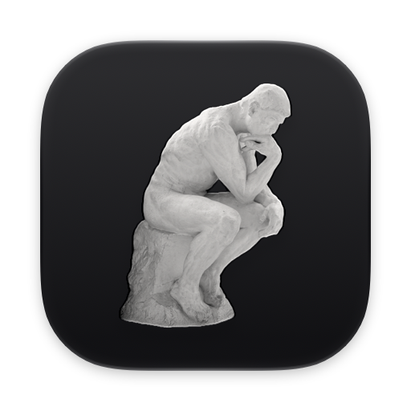
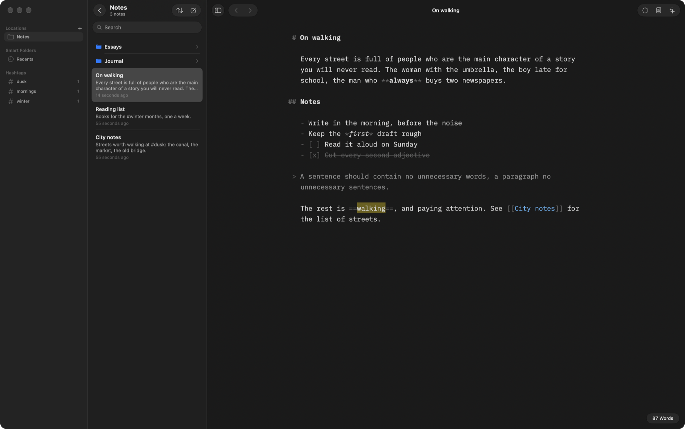

<p align="center">
  
</p>

<h1 align="center">Sonder markdown editor</h1>

<p align="center">
  <em>Sonder</em> (n.): the realization that each passerby has a life as vivid and complex as your own.
</p>

<p align="center">
  A native Mac app for writing in markdown.<br>
  Your notes stay plain text files in your own folders, with the syntax kept visible.
</p>

<p align="center">
  <a href="https://github.com/frizurd/sonder/releases/latest/download/Sonder.dmg"></a>
  <a href="https://frizky.dev/products/sonder"></a>
</p>

<p align="center">
  <sub>Free and open source · macOS 14 or later · Apple silicon and Intel</sub><br>
  <sub>Open the DMG and drag Sonder to Applications. New versions arrive in the app.</sub>
</p>



## Features

- **Editor**: markdown syntax stays visible in light gray; headings are body-sized and bold, and their `#` hangs in the margin. Line length is 64, 72 or 80 characters. Typefaces are Mono, Duo and Quattro, set in the bundled IBM Plex.
- **Focus Mode** (⌘D): dims everything except the current sentence or paragraph and keeps the caret centered. Typewriter does the centering without the dimming.
- **Syntax Highlight** (⇧⌘D): adjectives brown, nouns red, adverbs purple, verbs blue, conjunctions green.
- **Style Check** (⌥⇧⌘D): strikes through fillers, clichés, redundancies and your own patterns. It never changes the text.
- **Authorship** (⇧⌘A): typed text is attributed to you, pasted text is unattributed, and "Paste as AI/Reference" or "Mark Selection" attributes text explicitly. Authorship is saved as Markdown Annotations, an open format, at the end of the file.
- **Library** (⌃⌘S): Locations, Favorites (⌃1-9), Smart Folders (Recents and saved searches) and #hashtags; a File List with excerpts; rename, move, duplicate and trash. New files are named after their first line.
- **Open Quickly** (⌘P): fuzzy-find any note or folder by name or path, ranked by [fzf](https://github.com/junegunn/fzf) when it is installed (a built-in fzf-style matcher otherwise), plus notes that mention the words; a folder opens in the notes list, a note opens with its folder beside it. **⌘D** in the notes list moves the selected note to the Trash (⌘D elsewhere is Focus Mode). Print is ⇧⌘P.
- **Search** (⇧⌘O), `[[wikilinks]]` with autocomplete (⌘-click or ⌘⏎ to follow; Back/Forward is ⌃⌘←/→), and content blocks (`/image.png`, `/data.csv`, `/chapter.md` on their own line, autocompleted after `/`, or dragged in).
- **Preview** (⌘R): GitHub Flavored Markdown via cmark-gfm, with footnotes, tables, task lists, math (KaTeX) and front matter. Templates are Modern, Classic, Manuscript (Mono/Duo/Quattro) and GitHub.
- **Export** (⇧⌘E) to PDF, HTML, Word or Markdown; Print (⇧⌘P) and Print Plain Text (⌥⌘P); Copy Formatted (⌥⌘C), Copy as HTML (⇧⌘C) and Copy as Markdown with content blocks (⌃⌘C). Plain ⌘C always copies raw markdown.
- **Assistant** (⌥⌘I): ask the AI command-line tools already on your Mac about your text. Supported: Claude Code, Codex, Cursor, Gemini, Grok, Copilot, OpenCode, Qwen, Ollama and `llm`. The quick actions are Critique, Improve, Shorten, Fix Grammar, Continue, Summarize and Titles. Answers stay in the pane until you choose Insert, which adds them at the caret, or Apply Edits, which marks only the changed words as AI. Tools run headless in an empty temporary folder, with tools off where the CLI allows it.
- **Shortcuts**: ⌘1-6 headings, ⌘B/⌘I, ⌥⌘U strikethrough, ⇧⌘U highlight, ⌘J code, ⇧⌘J code block, ⌘K/⌥⌘K/⇧⌘K/⌃⌘K link/image/wikilink/footnote, ⌘L/⌥⌘L/⇧⌘L lists, ⌥⌘X complete task, ⌥⌘↑/↓ move lines, Tab/⇧Tab indent list items, ⌘+/⌘-/⌘0 text size, ⌃⌘N dark mode.

The default Library location is `~/Documents/Sonder`. Add more locations in the Organizer or in Settings.

## Build & run

```sh
scripts/build-app.sh          # → build/Sonder.app
scripts/build-dmg.sh          # → build/Sonder.dmg and build/appcast.xml (see the script for signing and notarizing)
open build/Sonder.app
swift test
AI_E2E=claude,codex swift test --filter AIEndToEndTests   # real CLI round trip
PERF=1 swift test -c release --filter PerformanceTests     # timings on a 250k-character note
```

Updates come through [Sparkle](https://sparkle-project.org): the app reads `appcast.xml` from the newest GitHub release once a day and offers new versions (Sonder › Check for Updates… checks now). To release, raise `CFBundleShortVersionString` and `CFBundleVersion` in `Resources/Info.plist`, run `scripts/build-dmg.sh` with `DEVELOPER_ID` and `NOTARY_PROFILE` set, then upload both files:

```sh
gh release create v0.1.1 build/Sonder.dmg build/appcast.xml --title "Sonder 0.1.1" --notes "..."
```

The app icon is the Icon Composer bundle `Resources/AppIcon.icon`, compiled by the build script with `actool`. Its artwork is Rodin's The Thinker, lifted from The Metropolitan Museum of Art's public-domain photo of the 1904 plaster cast ([object 209021](https://www.metmuseum.org/art/collection/search/209021)). The layer is rendered by `swift scripts/make-icon.swift <photo.jpg> <out.png> 1024 --layer`.

To check that clicks on the title-bar controls reach them, and where the first line and Focus Mode's caret line sit (an off-screen window; your settings are untouched):

```sh
SONDER_DEFAULTS_SUITE=snapshot SONDER_LIBRARY=/tmp/lib swift run Sonder --hit-test Resources/Welcome.md
```

To render the main window to PNGs (light and dark; with the Library, in Focus Mode, and with Syntax Highlight plus Style Check) without opening a window or touching your settings:

```sh
SONDER_DEFAULTS_SUITE=snapshot SONDER_LIBRARY=/tmp/lib swift run Sonder --snapshot Resources/Welcome.md /tmp/snapshots
```

## License

Sonder is released under the [MIT License](LICENSE). It bundles IBM Plex (SIL Open Font License, see `Resources/Fonts/LICENSE.txt`) and uses [swift-cmark](https://github.com/swiftlang/swift-cmark) (BSD 2-Clause) and [Sparkle](https://sparkle-project.org) (MIT).
